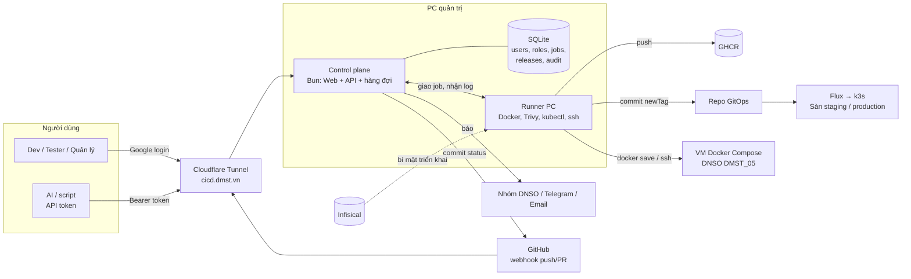
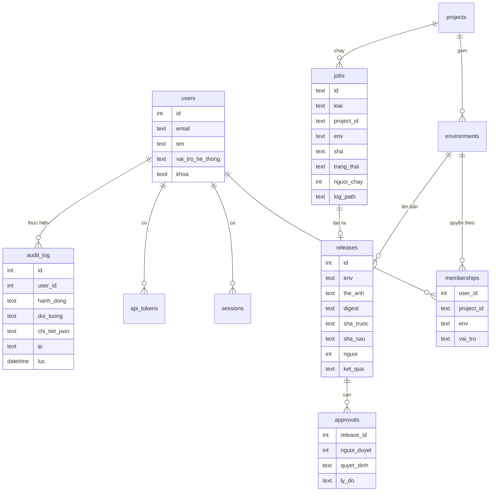

# Đề xuất: nâng stg-deploy thành nền tảng CI/CD nhiều dự án (DMST Deploy)

Ngày: 22/11/2026 · Trạng thái: **đã chốt phạm vi (27/11/2026)**, đang làm giai đoạn 1 · Repo: `vantt47/dmst-cicd`

## 0. Quyết định đã chốt (27/11/2026)

| # | Quyết định |
|---|---|
| 1 | Tên miền: **`cicd.dmst.vn`**. Ba trang cũ giữ nguyên tới khi chuyển xong, sau đó chuyển hướng về trang mới. |
| 2 | Đăng nhập: **chỉ Google**. Không mật khẩu chung, không GitHub OAuth. |
| 3 | **Super admin (owner) chỉ có một: Văn Nguyễn `vantt47@gmail.com`**, ghim trong mã. Giao diện/API không cấp được vai trò owner cho ai khác, không khoá/xoá/hạ quyền được tài khoản này. Có thể có thêm Admin hệ thống (do owner gán). |
| 4 | Phạm vi: **chỉ môi trường staging**. Production (prod-deploy-sangiaodich) giữ nguyên trang riêng hiện tại; mục A1–A5, quy tắc 2 người, `can_duyet` để giai đoạn sau. |
| 5 | Không áp dụng quy tắc 2 người (quyết định 23/11/2026). |

Dự án staging đưa sang nền tảng: Sàn TMĐT (`stg-deploy`), DNSO DMST_05 (`dnso-stg`), DNSO HappyFinate (`dnso-hf`), thi-vien-chuc (`tvc-stg`).

Việc thủ công cần làm: thêm public hostname `cicd.dmst.vn` → `http://127.0.0.1:8090` vào một tunnel trên tài khoản Cloudflare dmst.vn
(token API hiện không có quyền Tunnel ở tài khoản đó, phải làm trên dashboard hoặc nhờ chủ zone), và thêm
`https://cicd.dmst.vn` vào Authorized JavaScript origins của OAuth client Google dùng cho trang.

### Tiến độ

| Bước | Trạng thái |
|---|---|
| 1a. Lõi: SQLite, đăng nhập Google, phiên, token API, phân quyền dự án × môi trường, nhật ký kiểm toán, trang quản trị (người dùng, quyền, nhật ký, token) | Xong (27/11), bản xem trước |
| 1b. CI chung (`platform/ci.ts`), hàng đợi theo môi trường (`platform/queue.ts`), báo nhóm DNSO (`platform/notify.ts`) | Xong (27/11), bản xem trước |
| 1c. Adapter `gitops-kustomize` + **Sàn TMĐT staging** (`/p/san-tmdt/staging/`) | Xong (27/11), bản xem trước |
| 1d. Chạy thật song song stg-deploy (`PREVIEW=0`, `start.ps1`, tunnel `cicd.dmst.vn`) | Chưa: chờ tunnel + OAuth origin |
| 2. Adapter `ssh-compose` (DNSO DMST_05, DNSO HappyFinate), adapter k8s trực tiếp (thi-vien-chuc) | Chưa |
| 3. Tắt trang cũ, chuyển hướng tên miền cũ | Chưa |

**Bản xem trước** (`PREVIEW=1`, mặc định): đọc trạng thái thật (cụm, git, GHCR, kết quả CI của trang cũ); chạy kiểm tra,
build, push, commit đổi thẻ, Flux, restart, báo nhóm chỉ ghi lệnh ra log (`[THỬ] ...`). Không tự chạy CI khi push, không mở
tunnel. Chạy thử trên PC:

```powershell
bun platform/server.ts   # http://localhost:8090, WORK_DIR mặc định D:\DMST\cicd-preview-work
```

Đăng nhập Google ở `http://localhost:8090` cần thêm origin này vào OAuth client. Đã kiểm 27/11 trên CSDL tạm: 30 ca ma trận
quyền qua HTTP (chưa đăng nhập, không có quyền, viewer, developer, super admin; thiếu Origin bị chặn CSRF; super admin không
bị khoá/hạ quyền), một lượt Build & deploy và một lượt Đổi bản giả lập đọc đúng trạng thái thật của Sàn staging.

---

## 1. Hiện trạng

Có **3 tiến trình riêng**, mã chép gần giống nhau, mỗi cái một cổng, một tunnel, một `secrets.json`:

| Trang | Dự án | Đăng nhập | Kiểu triển khai | Cổng |
|---|---|---|---|---|
| stg-deploy-sangiaodich.dmst.vn | Sàn TMĐT, staging | Mật khẩu chung + gõ tên tự do | Build → GHCR → commit `newTag` → Flux (k3s) | 8099 |
| prod-deploy-sangiaodich.dmst.vn | Sàn TMĐT, production | Google, chỉ `ALLOWED_EMAILS` | Như trên, nhánh `main` | 8199 |
| stg-deploy-dnso.senow.tech | DNSO, staging | Mật khẩu chung + tên | Build → `docker save \| ssh` → `trien-khai.sh` blue/green (DMST_05) | 8097 |

Điểm tốt nên giữ: CI chạy trong container dùng một lần, chặn Build khi CI chưa đạt, Trivy, tự kiểm tra khi push,
báo nhóm DNSO, tự cập nhật mã từ `origin/main`, Bun không phụ thuộc gói.

Vấn đề:

1. **Không biết ai làm gì**: mật khẩu chung, tên tự gõ → không truy được trách nhiệm, không thu hồi riêng một người.
2. **Không phân quyền**: ai có mật khẩu staging là build/deploy/bypass CI được hết.
3. **Mỗi dự án mới = chép thêm một server ~800–1000 dòng**; sửa lỗi phải sửa nhiều chỗ (vd. lỗi rollout 0 bản sao).
4. Lịch sử job chỉ là file log, không tra cứu/thống kê được; khởi động lại là mất hàng đợi.
5. Production không có bước duyệt, có thể build lại từ mã thay vì dùng **đúng ảnh đã chạy ở staging**.
6. Mọi thứ dồn trên một PC (đã có ổ cắm tự bật + BIOS, nhưng vẫn là điểm chết duy nhất).

---

## 2. Mục tiêu

- **Một** trang, **một** tên miền, quản lý mọi dự án và môi trường (Sàn staging/production, DNSO staging, dự án sau).
- Đăng nhập cá nhân, phân quyền theo **dự án × môi trường**, nhật ký kiểm toán đầy đủ.
- Thêm dự án mới bằng **một file cấu hình**, không viết server mới.
- Production lên bản bằng **thăng cấp ảnh đã kiểm ở staging** + phê duyệt.
- Giữ nguyên chi phí ~0đ (chạy trên PC, Bun, SQLite có sẵn trong Bun, Cloudflare Tunnel, GHCR).

---

## 3. Kiến trúc đề xuất



**Thành phần:**

| Thành phần | Vai trò |
|---|---|
| Control plane | Web UI, API, đăng nhập, phân quyền, hàng đợi job, lịch, thông báo. Không tự chạy Docker. |
| Runner | Tiến trình nhận job (CI, build, deploy) và đẩy log về. Giai đoạn 1 chạy chung PC; sau có thể thêm runner thứ 2 trên VM để PC không còn là điểm chết. |
| Bộ chuyển đổi triển khai (adapter) | `gitops-kustomize` (Sàn: đổi `newTag` + Flux), `ssh-compose` (DNSO: save/load + script blue/green). Sau này thêm `static` (web tĩnh), `k8s-direct`. |
| Cấu hình dự án | `projects/<ma-du-an>.yaml` trong repo dmst-cicd, sửa qua PR → có review và lịch sử. |
| SQLite | `bun:sqlite`, một file trong WORK_DIR, sao lưu hằng đêm. |

**Ví dụ cấu hình dự án** (rút từ mã hiện có):

```yaml
id: san-tmdt
ten: Sàn TMĐT
repo: KHCN-Thanh-Hoa/5-san-tmdt
ci:
  dockerfile: ci/san-tmdt.Dockerfile
  nhom: [route-cu, quet-vitu, backend, phone, manage, seller-center]   # = GROUPS trong checks.ts
dich_vu:
  - { key: backend, image: ghcr.io/khcn-thanh-hoa/tmdt-backend, context: backend, scan: true }
  - { key: web, image: ghcr.io/khcn-thanh-hoa/tmdt-web, context: web, scan: true, build_args_theo_moi_truong: true }
  - { key: migrate, image: ghcr.io/khcn-thanh-hoa/tmdt-migrate, file: backend/Dockerfile.migrate }
moi_truong:
  staging:
    nhanh: staging
    trien_khai: { kieu: gitops-kustomize, kustomization: ecommerce-monorepo/deploy/k8s/clusters/staging, kubeconfig: tmdt-staging }
    tu_dong_deploy: false
  production:
    nhanh: main
    trien_khai: { kieu: gitops-kustomize, kustomization: ecommerce-monorepo/deploy/k8s/clusters/production, kubeconfig: tmdt-production }
    chi_thang_cap_tu: staging      # không build lại, dùng đúng ảnh đã chạy staging
    can_duyet: 1
thong_bao:
  - { kenh: dnso, nhom: 6022b5f0-e3d4-44df-9a7c-edcf0b01432d }
```

---

## 4. Đăng nhập và phân quyền

### 4.1 Đăng nhập

- [ ] **Google** (đã có ở prod-deploy) là cách chính; bỏ mật khẩu chung.
- [ ] Thêm **GitHub OAuth** (dev nào cũng có GitHub; ánh xạ được người push với người deploy).
- [ ] Chỉ người được **mời** mới vào được (Admin nhập email → người đó đăng nhập lần đầu là kích hoạt). Không tự đăng ký.
- [ ] Phiên lưu trong DB, có trang "Phiên đang mở", **thu hồi ngay** khi khoá tài khoản.
- [ ] **API token cá nhân** (có hạn dùng, phạm vi dự án/quyền) cho script và AI. Token gắn với người tạo, nên tên trong
      tin báo DNSO là người đó (thay cho cách hiện nay AI đăng nhập bằng tên "Nguyễn Duy Văn").
- [ ] Hành động nhạy cảm (deploy production, bypass CI, đổi quyền) yêu cầu **đăng nhập lại trong 15 phút gần nhất**.
- [ ] (Tuỳ chọn) Đặt thêm **Cloudflare Access** trước tên miền như lớp chắn thứ hai. Lưu ý: token Cloudflare hiện không có quyền Access trên dmst.vn.

### 4.2 Vai trò

Hai cấp: **toàn hệ thống** và **theo dự án × môi trường** (một người có thể là Developer ở staging nhưng chỉ Viewer ở production).

| Vai trò | Cấp | Ý nghĩa |
|---|---|---|
| Owner | Hệ thống | Toàn quyền, quản lý Admin, cấu hình runner, bí mật hệ thống. |
| Admin | Hệ thống | Thêm/khoá người dùng, gán quyền mọi dự án, xem audit toàn bộ. |
| Project Admin | Dự án | Gán quyền trong dự án, sửa thông báo, đóng băng triển khai. |
| Releaser | Dự án × MT | Deploy/thăng cấp/rollback, duyệt yêu cầu deploy của người khác. |
| Developer | Dự án × MT | Chạy CI, Build, deploy (nếu môi trường không yêu cầu duyệt), restart service. |
| Tester | Dự án × MT | Deploy **thẻ có sẵn** đã qua CI (chọn bản để test), restart, xem log. Không build. |
| Viewer | Dự án × MT | Xem trạng thái, lịch sử, log job (log đã che bí mật). |

### 4.3 Ma trận quyền (đề xuất mặc định)

| Quyền | Viewer | Tester | Developer | Releaser | Project Admin |
|---|:-:|:-:|:-:|:-:|:-:|
| Xem trạng thái, pod, lịch sử | ✓ | ✓ | ✓ | ✓ | ✓ |
| Xem log job | ✓ | ✓ | ✓ | ✓ | ✓ |
| Xem log pod trực tiếp | | ✓ | ✓ | ✓ | ✓ |
| Chạy CI | | | ✓ | ✓ | ✓ |
| Build ảnh | | | ✓ | ✓ | ✓ |
| Deploy thẻ có sẵn (staging) | | ✓ | ✓ | ✓ | ✓ |
| Restart service | | ✓ | ✓ | ✓ | ✓ |
| Gửi yêu cầu deploy production | | | ✓ | ✓ | ✓ |
| Duyệt + chạy deploy production / rollback | | | | ✓ | ✓ |
| Bỏ qua chặn CI/Trivy (khẩn cấp, bắt buộc ghi lý do) | | | | ✓ | ✓ |
| Đóng băng triển khai, sửa kênh thông báo | | | | | ✓ |
| Gán quyền trong dự án | | | | | ✓ |

- [ ] Đồng ý ma trận trên (hoặc ghi chỗ cần sửa).
- [ ] Production: **người gửi yêu cầu không được tự duyệt** (quy tắc 2 người). Riêng Owner được tự duyệt khi khẩn cấp, có ghi lý do.

---

## 5. Tính năng lõi (bắt buộc để thay 3 trang hiện tại)

1. **Bảng điều khiển nhiều dự án**: mỗi dự án × môi trường một thẻ: bản đang chạy (commit, thẻ ảnh, ai deploy, lúc nào), CI đầu nhánh, pod lỗi.
2. **CI**: như hiện tại (container dùng một lần, `git archive`), nhưng nhóm job đọc từ cấu hình dự án; hàng đợi chung, giới hạn số job song song theo runner.
3. **Build + quét Trivy + push GHCR**, bỏ qua khi thẻ đã có (giữ logic hiện có).
4. **Deploy** qua adapter (`gitops-kustomize`, `ssh-compose`), kiểm tra lành sau deploy (rollout, `/suc-khoe`).
5. **Lịch sử release**: mỗi lần deploy là một bản ghi (môi trường, thẻ, digest, commit trước/sau, người, kết quả, log).
6. **Rollback một bấm** về release trước (không migrate ngược; cảnh báo nếu bản giữa có migration).
7. **Nhật ký kiểm toán**: đăng nhập, đổi quyền, build, deploy, bypass, duyệt; chỉ ghi thêm, không sửa được.
8. **Báo nhóm DNSO** theo cấu hình từng dự án (giữ định dạng ngắn cho non-tech đã chốt 14/11).
9. **Tự cập nhật mã** từ `origin/main` như hiện nay.

---

## 6. Tính năng đề xuất thêm (chờ duyệt từng mục)

### Nhóm A: an toàn khi lên production (khuyên làm)

- [ ] **A1. Thăng cấp staging → production bằng đúng digest ảnh**, không build lại. Production chỉ nhận ảnh đã chạy ở staging ≥ N phút và CI đạt.
- [ ] **A2. Yêu cầu + phê duyệt deploy production**, kèm danh sách commit sẽ lên (dịch Mới/Sửa lỗi như tin DNSO), có hạn duyệt 24h.
- [ ] **A3. Sao lưu CSDL production tự động trước khi chạy migrate** (đã có script sao lưu trong quy trình chép staging→production; gắn vào bước deploy).
- [ ] **A4. Đóng băng triển khai / khung giờ deploy** (vd. cấm deploy production sau 17h và cuối tuần trừ khi Releaser bypass có lý do).
- [ ] **A5. Tự rollback** khi rollout không lành sau X phút.
- [ ] **A6. Khoá môi trường**: một người "giữ" staging để test, người khác deploy phải chờ hoặc xin nhả (tránh tester đang test bị đè bản).

### Nhóm B: tiện cho dev và tester

- [ ] **B1. Webhook GitHub** thay cho dò 60 giây (nhanh hơn, ít gọi API). Giữ dò làm dự phòng.
- [ ] **B2. Gửi trạng thái CI ngược lên GitHub** (dấu ✓/✗ trên commit và PR), vì Actions của org đang bị khoá thanh toán. Cần token có quyền `repo:status`.
- [ ] **B3. Xem log pod / log trực tiếp của job** ngay trên trang (stream), lọc theo service.
- [ ] **B4. So sánh môi trường**: staging đang hơn production bao nhiêu commit, những commit nào.
- [ ] **B5. Lịch chạy định kỳ**: CI đầy đủ hằng đêm trên `staging` và `main`, quét Trivy lại ảnh đang chạy (lỗ hổng mới công bố).
- [ ] **B6. Môi trường xem trước theo PR** (mỗi PR một namespace tạm trên cụm staging, tự xoá khi đóng PR). Tốn RAM cụm, nên để giai đoạn sau.
- [ ] **B7. Nút "Chạy lại" và "Huỷ" job**, xếp ưu tiên (deploy hotfix chen trước CI thường).

### Nhóm C: vận hành và quan sát

- [ ] **C1. Trang sức khoẻ hạ tầng**: runner, Docker, dung lượng ổ PC, Tailscale tới từng cụm/VM, hạn chứng chỉ, tunnel.
- [ ] **C2. Tự dọn ảnh/cache** theo chính sách từng dự án (đang làm tay theo ghi chú 12/11).
- [ ] **C3. Chỉ số DORA**: số lần deploy/tuần, thời gian từ commit đến production, tỉ lệ deploy lỗi, thời gian khôi phục.
- [ ] **C4. Thêm kênh thông báo**: Telegram/Email cho Releaser khi có yêu cầu duyệt, khi production lỗi.
- [ ] **C5. Runner thứ 2 trên VM** để PC tắt vẫn deploy được (VM cần Docker, quyền SSH/kubeconfig; build chậm hơn PC).
- [ ] **C6. Sao lưu DB của nền tảng** hằng đêm (SQLite → Google Drive hoặc R2).

### Nhóm D: bí mật và tuân thủ

- [ ] **D1. Bí mật triển khai lấy từ Infisical** (mỗi dự án một project), thay cho `secrets.json` rải rác; trang chỉ hiển thị tên khoá, không bao giờ hiển thị giá trị.
- [ ] **D2. Che bí mật trong log job** (thay giá trị đã biết bằng `***`).
- [ ] **D3. SBOM + ký ảnh (cosign)**, lưu kèm release; cụm chỉ nhận ảnh đã ký. Phức tạp, để sau.
- [ ] **D4. Xuất báo cáo kiểm toán** theo tháng (ai deploy gì lên production) dạng CSV/Markdown.

---

## 7. Mô hình dữ liệu (SQLite)



Cấu hình dự án (service, build, adapter) nằm trong YAML ở repo; DB chỉ chứa dữ liệu vận hành.

---

## 8. Lộ trình

| Giai đoạn | Nội dung | Ước lượng | Kết quả |
|---|---|---|---|
| 0 | Chốt đề xuất này | — | Danh sách mục đã duyệt |
| 1. Nền | Server chung, SQLite, Google login + mời người dùng, RBAC, audit, API token, cấu hình YAML, adapter `gitops-kustomize`. Đưa **Sàn staging** sang, chạy song song trang cũ 1 tuần. | 4–5 ngày | `cicd.dmst.vn` thay stg-deploy |
| 2. Mở rộng | Adapter `ssh-compose`, đưa **DNSO staging** sang; đưa **Sàn production** sang với A1 + A2 + A3. Tắt 3 trang cũ, gỡ tunnel thừa. | 3–4 ngày | Một trang cho cả 3 |
| 3. Tiện ích | Các mục đã duyệt của nhóm B, C1, C2, C4, D1, D2 | 3–5 ngày | |
| 4. Nâng cao | B6, C3, C5, D3 (nếu duyệt) | tuỳ mục | |

Chuyển đổi không gián đoạn: trang mới đọc lại lịch sử thẻ từ git (commit đổi `newTag`) và log job cũ để có lịch sử ngay từ đầu;
trang cũ chỉ tắt sau khi trang mới đã deploy thành công ít nhất một lượt mỗi môi trường.

---

## 9. Các quyết định cần anh chốt

> Đã trả lời 27/11/2026, xem mục 0: (1) `cicd.dmst.vn`, (2) chỉ Google, (3) owner duy nhất `vantt47@gmail.com`, (5) không quy tắc 2 người, phạm vi chỉ staging. Còn mở: (4) danh sách người dùng ban đầu, (6) tester deploy staging (mặc định: được, theo ma trận 4.3), (7), (8), (9) giữ như hiện tại.

1. **Tên miền**: `cicd.dmst.vn` (theo quy ước `<vai-trò>-<dự-án>.dmst.vn`) hay tên khác? Có giữ chuyển hướng từ 3 tên miền cũ không?
2. **Đăng nhập**: chỉ Google, hay Google + GitHub?
3. **Owner/Admin ban đầu**: chỉ `vantt47@gmail.com`, hay thêm ai?
4. **Danh sách người dùng và vai trò ban đầu** (email → dự án → vai trò). Có thể gửi sau, tôi tạo sẵn màn hình mời.
5. **Production có bắt buộc quy tắc 2 người** (người gửi ≠ người duyệt) không, hay giai đoạn đầu cho tự duyệt?
6. **Tester có được deploy staging** (thẻ có sẵn) không, hay chỉ xem?
7. **Runner thứ 2 trên VM** (C5): có muốn bỏ phụ thuộc PC ngay không? Nếu có, dùng VM nào?
8. **Nơi viết mã**: tiếp tục repo `vantt47/dmst-cicd` (cá nhân) hay chuyển sang org `KHCN-Thanh-Hoa`?
9. **Giữ "Bun, không gói phụ thuộc"**? Riêng giao diện, đề xuất vẫn HTML + JS thuần như hiện tại (nhẹ, không bước build).

---

## 10. Rủi ro và cách giảm

| Rủi ro | Cách giảm |
|---|---|
| PC tắt/mất mạng → không ai deploy được | C5 runner VM; ngắn hạn đã có ổ cắm tự bật + BIOS + Tailscale RDP |
| Lỗi phân quyền để lộ quyền production | Kiểm tra quyền ở **server** cho mọi API (không chỉ ẩn nút), test tự động ma trận quyền, re-auth cho hành động nhạy cảm |
| Dồn 3 trang thành 1 → một lỗi làm hỏng cả 3 | Chạy song song trang cũ trong giai đoạn 1–2; adapter tách riêng, lỗi một dự án không chặn hàng đợi dự án khác |
| Lộ token GitHub/Cloudflare trong log | D2 che bí mật; token phạm vi hẹp cho từng việc thay vì token classic rộng |
| Webhook GitHub mở ra Internet | Kiểm chữ ký HMAC của webhook, chỉ nhận đường dẫn `/hooks/github` |
